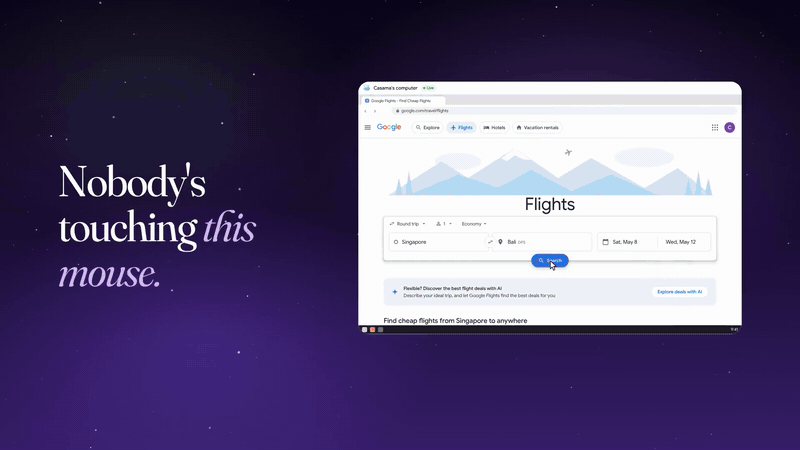

<h1 align="center">Casama</h1>

<p align="center">
  <strong>Casama™: AI bots with their own computers.</strong><br>
  Bots that remember, reach out first, work on real computers and ask before risky steps.
</p>

<p align="center">
  <a href="https://casama.ai">casama.ai</a> ·
  <a href="https://app.casama.ai">Open the app</a> ·
  <a href="https://casama.ai/docs">Docs</a> ·
  <a href="https://gallery.casama.ai">Gallery</a> ·
  <a href="https://discord.gg/e86XbXFHwz">Discord</a>
</p>

<p align="center">
  <a href="https://casama.ai">
    
  </a>
</p>

<p align="center">
  <strong>Try it:</strong> <a href="https://app.casama.ai">open the web app</a>, or
  <a href="https://casama.ai/download">get the app</a> for your phone, computer or watch.
</p>

<p align="center">
  Casama is open source. If it's useful to you, a star on GitHub helps other people find it.
</p>

---

## What is Casama?

Casama gives you AI bots that each have their own computer. A bot remembers how you work, browses,
fills in forms, writes files and runs code on a sandboxed machine you can watch and take over. It
starts work on schedules and triggers, so it keeps going after you close the chat. It asks before
anything risky.

You use Casama on your phone, on desktop (Mac, Windows and Linux), on the web, on your watch, and
from the command line.

**Casama is open source.** The apps, the safety rules and the developer kit in this repo are open.
The Casama Engine behind Casama Cloud is not. [LICENSING.md](LICENSING.md) says exactly what is
open.

## What's in this repo

| Folder | What it is | License |
|---|---|---|
| `client/` | The apps: iOS, Android, macOS, Windows, Linux, web, Apple Watch (`client/ios/CasamaWatch`) and Wear OS (`client/wear`) | AGPL-3.0 |
| `apps/extension` | The browser extension | AGPL-3.0 |
| `dart/computerd` | The agent inside each bot's computer | AGPL-3.0 |
| `packages/safety` | When a bot must ask first, what it may never do, roles, quiet hours, hiding secrets | AGPL-3.0 |
| `infra/images/computer` | What is installed on a bot's computer | AGPL-3.0 |
| `infra/egress-proxy` | The network guard every computer goes through | AGPL-3.0 |
| `packages/client`, `dart/casama_api`, `dart/casama_sdk` | TypeScript and Dart SDKs | Apache-2.0 |
| `dart/cli` | The `casama` command | Apache-2.0 |
| `packages/mcp`, `packages/plugin-check` | MCP server and plugin checker | Apache-2.0 |
| `packages/contracts`, `packages/formats` | API schemas and builder file formats | Apache-2.0 |
| `agent-kit/`, `examples/`, `packs/`, `skills/` | Build-on-Casama kit | Apache-2.0 |
| `docs-site/` | The public docs | Apache-2.0 |

The Casama Engine (API, worker, agent, supervisor, database) is not in this repo. Casama Cloud runs
on it.

## Casama Cloud

The apps connect to Casama Cloud at `https://api.casama.ai`. Sign up in the apps or at
[app.casama.ai](https://app.casama.ai). Casama can also run on your own computer or
server. The engine installs as signed images under a license, free for personal use and paid for
business use: see [self-hosting](https://docs.casama.ai/self-hosting/).

## Build from this repo

You need Node.js 24 and pnpm 12 for the TypeScript packages, Dart 3 for the CLI and SDKs, and
Flutter 3.50 for the apps.

```sh
pnpm install
pnpm --filter @casama/client typecheck test      # the TypeScript SDK
pnpm --filter @casama/mcp typecheck test         # the MCP server
pnpm --filter @casama/safety typecheck test      # the safety rules
(cd dart && dart pub get && dart analyze && dart test cli casama_sdk computerd)
(cd client && flutter analyze && flutter test)   # the apps
```

Run an app against Casama Cloud:

```sh
cd client
flutter run -d macos --dart-define=CASAMA_API_URL=https://api.casama.ai
```

Use `-d chrome`, a simulator or an emulator instead of `macos` as you like. Official store builds
are made by Stackwares.

Build on Casama with the SDKs, the CLI or the MCP server: see the
[developer docs](https://casama.ai/docs/develop/api) and `agent-kit/`.

## Contributing and security

Pull requests are welcome on the open folders. See [CONTRIBUTING.md](CONTRIBUTING.md) and the
[CLA](CLA.md). Report security issues as [SECURITY.md](SECURITY.md) says. Please follow the
[Code of Conduct](CODE_OF_CONDUCT.md).

## License

AGPL-3.0 for the apps, `computerd`, the safety rules, the computer image and the network guard.
Apache-2.0 for the SDKs, CLI, MCP server, schemas, formats, kit and docs. Each folder has its own
`LICENSE`. See [LICENSING.md](LICENSING.md). "Casama" and the logo are trademarks of Stackwares:
[TRADEMARKS.md](TRADEMARKS.md).
